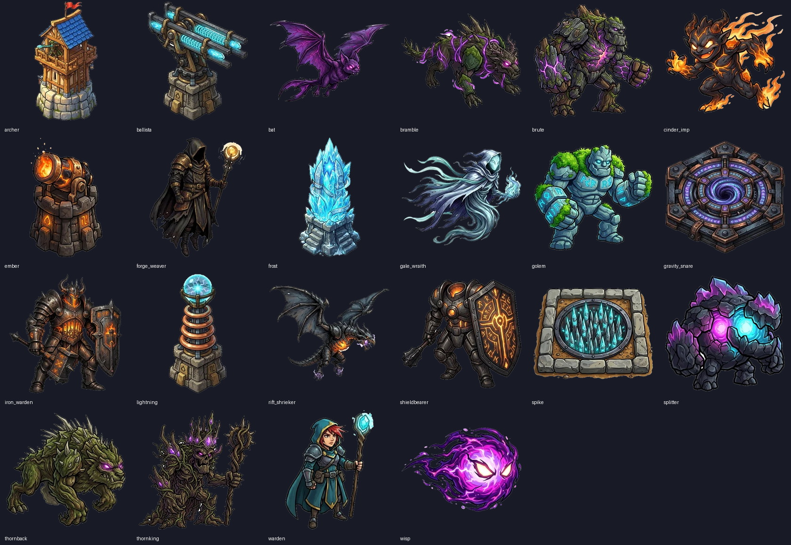

# Session Log

Newest entry at the top. Each session adds one entry.

---

## Bug reports and ideas (Mr. Scott, November 22, 2026)

Newest at the top. Fix in a real session; move each one into a session entry when it is done.

| # | Report | Type | Goes with |
|---|---|---|---|
| B1 | ✅ Fixed in v0.16.1 (saved with the settings; tested across levels and a page reload). **2x speed resets when the level changes.** It should stay on until the player switches it back (save it with the settings). | Bug, small | Sonnet, any session |
| B7 | **Balance: one Storm Spire beats Level 4** (Mr. Scott won all 4 waves with one fully upgraded Lightning Spire, using test crystals). Math (Claude): the full spire costs 640 (150 + 100 + 140 + 250 specialty); Level 4 starts with 150, so 490 to earn. A perfect reader earns about 13 a word in tap mode (10 per word, 20 per rune at 30% runes) plus a Mega Forge of 100 every 8 words, about 25 a word in all: **about 20 words, which is the second wave.** Speak mode is about 17 words. The Mega Forge is about half of all income. For Arsenal step 4: give spires a creature they cannot handle (Grounded) in Level 4 and up, shrink the Mega Forge or make it grow slower, and add the sim test where a one-defender build loses. | Balance | ARSENAL.md step 4 |
| B6 | ✅ Built in v0.16.4. **Defender popups close on their own** (Mr. Scott): a fully upgraded defender's popup closes after 3 seconds; build and upgrade popups after 8 seconds with no touch. Touching the popup restarts the count, and a mouse resting on it keeps it open. Tapping the battlefield still closes it right away. | Bug | Battle |
| B5 | **Spoken runes, Level 1 test (Say it for runes on, Nov 22):** "kib" passed (100) and "yat" passed (94). **"baf" failed twice, read correctly:** the readout says "azure expected i, checked as æ; vowel i 0 (sounded most like æ)" and lists 4 sounds for a 3-letter word (33 8 65 85; 36 0 56 85; 25 0 54 81). So Azure guesses its own pronunciation for a made-up word, guessed wrong (a long e and an extra sound), and the game's remap to æ does not reach the pass decision. The "baf" that passed ("Second try, and it landed") shows the same bad scores (vowel i 0, sounds 38 16 59 83, word 65), so Azure never actually accepted it; the pass came from the second try path (a tap on the right choice, or a readout left over from the first try). Check which during the fix: the readout should always match the try it describes. **More baf tests:** read right, vowel 0 each time (sounds 30 0 49 81; 25 5 54 86; 37 0 66 73). He then said "beef", "baef", "bif" (short and long), "blast" and other words: **every one showed "The game heard: baf".** In Azure mode that line is the target word, never what was heard, because pronunciation assessment scores against the target and does not write down what was said. Fix: in Test mode, show what Chrome heard (or "Azure does not transcribe") instead. "beef" got word 84 but vowel 2 and failed, so the vowel check still blocked it. Conclusion: Azure cannot judge "baf" at all; keep runes tap only for students until runes are sent to Azure with exact sounds. **v0.16.3:** "baf" marked noSpeak (tap only, like pid); no vowel Mr. Scott tried would pass. **Level 2 test:** every other word and rune worked when spoken, including made-up words; some short o words scored low (watch short o in the fix). "kib" passed with vowel 58, sounds 93 87, word 87. **Level 3 test:** everything passed first try except "vep" (vowel ɛ 47, closest æ; first sound 43) and "net" (vowel ɛ 72 but closest æ; first sound 58). Both passed on the second try (vep: ɛ 91, v 71; net: ɛ 100, n 100). Read: both misses failed on the vowel, and both had a low first sound, which fits the start-up clip; a clipped start throws off Azure's timing for the whole word. Consonant scores do not decide a pass, so loosening them would change nothing. Idea for item 8: "net" failed with the right vowel at 72 because æ scored a little higher; consider failing only when another vowel beats the right one by a clear margin, and only for close pairs (e/a, i/e). Keep clear swaps failing. **Level 4 test (with the half-second pause):** all five rift locks filled, including short u, so short u read aloud passes when the start is not clipped. Supports the start-up clip as the main cause of B2 ("cut"). Fix ideas for item 8: for runes, judge the vowel by the expected short vowel from our word list, never by Azure's guess; match sounds by position when Azure splits the word differently; or send Azure the exact sounds (IPA) the way the voice files already do. Also from this test: "dig" failed once (first sound 29, vowel 58, word 53), then passed (99) on the next try, which fits the mic start-up clip. | Bug | Tightening plan item 8 (mic) |
| B4 | ✅ Built in v0.16.2. **Teacher setting "Say it for runes"** (Mr. Scott): off by default; when on, runes get the Say it button again. Works only with the Azure checker (Chrome cannot match made-up words). Known from Session 11: Azure reads "pid" as letters, so it stays tap only. | Request | Teacher settings |
| B3 | **Mic too loose on story cards (World 8 read aloud, test mode):** Mr. Scott read "Warden" with a long e (/wɔrdin/) and "ready" with a long a (/reɪdi/) on purpose. Azure scored Warden 91 and ready 54, and both counted right (the pass line is 50; "ready" was flagged low but still passed). Wrong vowels must not pass. For the mic fix: check story words against the expected vowel the same way single words are (vowelMin), look at the vowel's phoneme score instead of the whole-word score, and consider raising the story pass line. Test with these two words. **Second test (same day):** he said "Each" with a long a and "before" as "bafore". Both were caught (marked missed, i>eɪ), so the vowel check does work on some story words. Pattern: it catches a wrong vowel when Azure reports a clear vowel swap, but missed Warden (wrong vowel in an unstressed syllable) and ready (low score 54 with no swap reported, so it passed on the 50 line). **Third test:** "cricks" for cracks (scored 88 overall, caught as æ>ɪ) and "stains" for stones (24, caught as oʊ>eɪ). Both correct catches. Note that cracks scored 88 as a whole word and was caught only by the vowel check, which shows the whole-word score alone is not enough; the vowel check has to run on every story word. Running tally: 4 of 6 wrong vowels caught. **Fourth test (planned errors):** "ridder" for rider caught (48, aɪ>ɪ). Skipped "low" caught (0). "ets" for its caught (91, reported as ɪ>æ, close enough). "wangs" for wings caught (70, ɪ>æ). "teering" for tearing **passed at 100**: Azure seems to accept either reading of a word with two pronunciations (tear: rip or cry), so homographs need the meaning-matched pronunciation set for each card. Running tally: 7 of 10 wrong vowels caught, plus the skipped word. Short vowel swaps were caught on story cards. **Fifth test (clean read):** card 12, 18 of 18 right, lowest score 94, no false misses. So on story cards the problem is passing wrong vowels (B3), not rejecting right ones; false misses so far only happen on single Forge words (B2). Also fix the Test mode readout: "i" there is the IPA symbol for long e, but the legend says it means short i, which is confusing. | Bug | Tightening plan item 8 (mic) |
| B2 | ✅ Start-up clip fixed in v0.17.1 (warm mic, pre-roll, Wait/Listening signal, free redo); Chromebook test passed Nov 27. **Mic missed 3 words he read correctly:** "top" (short o), "pin" (short i), "cut" (short u). Add these to the mic test set. **Screenshot, "pin" read correctly (Nov 22):** the recognizer's text was "pin", but Azure scored the vowel ɪ at 21 (closest to æ), first sound 30, last 76, word 74, so it failed and the rule card came up. Two likely causes to check: (1) **the first sound scored 30**, which points to the mic starting late and clipping the p (start-up lag, already on the item 8 list); (2) **Texas Gulf Coast speech:** short i and short e often sound alike before n and m (pin and pen), the pin-pen merger, which is common in Mr. Scott's area and likely among his students. Ideas for the fix: when the recognized text is exactly the target word and the vowel score is low but no other taught vowel scores clearly higher, retry or accept instead of failing; never put an i/e pair before m or n as speak-mode choices (pin/pen, him/hem); keep rejecting a clear swap (cricks for cracks). Reading call for the mic session (Opus). **Pause test (same day):** Mr. Scott pressed Say It, paused, then said "pin". Try 1: heard nothing (""). Try 2, same pause: passed, word 92, sounds 99 / 100 / 81 (p, i, n). So **the accent was not the problem; the mic start was.** Saying the word right away clips the first sound and wrecks the vowel score; waiting too long can end the listening window before the word comes. Fix priority for item 8: open the mic before the student taps (keep it warm between words), show a clear "Go" signal the instant it is really recording, and keep listening long enough after that for a slow reader. Still check the pin-pen idea with real students, but it is lower priority now. **Confirmed (Nov 22):** speaking the instant Say It is pressed misses; waiting about half a second works almost every time. The mic needs about 0.5 seconds to start, and nothing tells the student when it is ready. | Bug | Tightening plan item 8 (mic) |
| I1 | **New defender: Sticky Foam Gun.** Sprays a creature with sticky foam that slows it or holds it in place. Upgrades: longer-lasting foam; acid foam (adds Acid damage); one shot hits several creatures. | Idea | `docs/ARSENAL.md` |

---

## Session 25: November 27, 2026 (Studio art brought in)

Checklist Step 3b. The game looks and plays the same; this adds the pictures and trail data that 3c will draw.

- **Added:** `assets/art/maps` (7), `assets/art/characters` (22: 6 creatures, 7 defenders, the Warden, the Thorn King, 7 later-world pictures), `assets/art/cards` (7 level card stills). About 2 MB in all. Credits recorded. The website publish step now copies `assets/art`.
- **Cutouts:** white backgrounds removed ahead of time, including white gaps trapped inside outlines. The Rift Wisp's white eye was kept. A few tiny light specks remain.

- **Trail data:** `map`, `pathUv`, `riftUv`, `anchorUv`, `noBuild` and `trailTime` added to every level in `levels-w1.json`; Boot Camp's under `bootCamp`. The old 3D trail data stays. Trails drawn over each map line up with the painted roads.
- **trailTime:** Level 1 1.0, Level 2 0.587, Level 3 0.734, Level 4 0.771, Level 5 0.592, final 0.786. Nothing reads it yet.
- **For 3c:** read the "Data as imported" note in DESIGN 13.1. Some lava on the final map has no outline yet. The all-in-one file does not include the pictures yet; 3c needs to add them to `tools/build_single.py`.
- **Tested:** the game loads, the new data reads, and Level 2 starts. The only error was the speech service, unreachable from the test computer. Not tested on the live site.
- **Next up:** Step 3c, painted battle engine, World 1 Level 1 (Sonnet, about 2 sessions, then an Opus review).

---

## Session 24: November 27, 2026 (painted battlefield rebuild plan)

Checklist Step 3a. Planning only; the game is unchanged.

- **Plan written:** DESIGN 13.1 (pointer in DESIGN 3). Rules stay in `battle.js`; a new `paint.js` draws the painted battlefield and a new `art.js` loads pictures from `game/data/art.json`. Map units keep their size (the 1600 x 900 painted map is 64 x 36 units), so defender ranges and creature speeds keep their numbers.
- **Studio art checked (read only):** 12 maps, 22 character pictures, 23 cut scene stills. Every picture is a JPG with a white background, so 3b cuts the backgrounds out ahead of time and saves WebP. Ready now: all six World 1 creatures, seven defenders (the rail turret stands in for the Ballista), the Warden and the Thorn King. Missing: Vine Snare, Healing Shrine, Barricade, a wooden Ballista, the world map, a Thorn King map, a World 8 map, walk frames. Those go to Step 4 work orders. The opening cut scene stills become level card pictures.
- **Maps picked:** Level 1 Thornwood Edge, Level 2 Bramble Crossing, Level 3 Hollow Bridge, Level 4 Thornking Heart, Level 5 Sunless Ruins, final level Furnace Core (stand-in), Boot Camp Basic Training. The Studio's traced trails come with them.
- **Found:** the painted trails for Levels 2 to 5 and the final level are 22 to 41% shorter than today's, which would make those levels harder. Fix in the plan: a per-level `trailTime` speed scale so the walk takes as long as now.
- **Decided (Claude):** Step 3d builds the ARSENAL damage types and traits (Arsenal build step 1, already approved) with the Studio's colored health bar badges, instead of copying the Studio's five resistances. Tower targeting First, Last, Strong comes in the same step.
- **Checklist:** 3a checked; 3b to 3f filled in with the details; Step 4 lists the known art gaps.
- **Next up:** Step 3b, bring in the Studio art (Sonnet).

---

## Session 23: November 27, 2026 (animated 3D graphics test)

Checklist Step 2. A separate test page; the game itself is unchanged.

- **Built:** `game/graphics-test.html`, a small battlefield made from the game's own models plus new characters that really move: Rift Grunts that walk with swinging arms and legs, fast four-legged Skitters with swishing tails, flapping bats, stomping Brutes and Thornbacks, two camp runners carrying crystals between the towers, and the hero on patrol. Towers turn and fire (arrows, lightning, lobbed embers, a frost slow), with hit sparks, squash on hits, health bars and pop-and-spin defeats. Characters have a dark cartoon outline on High.
- **Built for Chromebooks:** each character's still pieces are merged so a creature draws in about 6 pieces instead of 15 or more, and the gate, camp and still towers are merged into a few big meshes. Draw calls: about 370 with 15 creatures, 1,150 with 80 (Low) and 1,280 (High).
- **Speed meter:** frames per second with Smooth (50+), Playable (30 to 49) or Choppy (under 30), the quality level, creature count and draw calls. Auto quality steps down from High to Medium to Low after 3 seconds under 40 fps. High: sharp picture, soft shadows, outlines. Medium: normal resolution, shadows, outlines. Low: lower resolution, no shadows, no outlines.
- **Run 30-second test:** 10 seconds each at 15, 40 and 80 creatures, then a result with average and slowest fps and a verdict, plus a Copy result button.
- **Tested here:** loads with no errors; the test runs and reports. This computer has no graphics chip, so its frame rate (about 5 fps) means nothing. The Chromebook numbers decide.
- **Try (Chromebook):** open the link, leave Quality on High, press Run 30-second test, wait 30 seconds, press Copy result and paste it to Claude. Then try Auto for a minute with 40 creatures and say whether it looks smooth to your eye.
- **What the result decides:** 40 creatures at 45 fps or better means the animated 3D direction is safe. Fine at 15 but slow at 80 means big waves need instancing (drawing many copies of a creature in one call), about one Opus session. Choppy at 15 means the painted 2D fallback.
- **Mic test (Step 1):** Mr. Scott tested the warm mic on a Chromebook: passed.
- **Result (Mr. Scott's MSI laptop):** 60 fps at 15, 40 and 80 creatures, on High. He found the 3D look still lacking next to the Studio version.
- **Decision:** full painted rebuild of the battlefield, like the Studio version (Claude offered a cheaper hybrid; he chose the full rebuild). Checklist, DESIGN 3, 13 and 14 and the progress page updated. The Studio version draws a painted map per level on a flat canvas with one painted picture per creature and defender, and that art (made by Mr. Scott in Gemini) can come over first.
- **Next up:** Step 3a, the rebuild plan (Opus).

---

## Session 22: November 27, 2026 (mic fix: warm mic and free redo, v0.17.1)

Checklist Step 1. Built and tested here with a fake mic and a stand-in checker (no real mic or Azure from this computer).

- **Warm mic (bug B2):** the mic now opens once and stays open between words, keeping only the last third of a second until Say it is pressed. The word sent to Azure starts a moment before the voice, so the first sound is never cut off. Test: a word spoken the instant Say it was pressed lost its first 0.2 seconds the old way; with the warm mic the whole word arrived plus 0.3 seconds of lead-in. The mic closes at level end, when the tab is hidden, and after 90 seconds with no reading.
- **Wait, then Listening:** when the mic is not open yet (first press of a visit, or before permission), the button shows an amber WAIT until it is really recording, then the red LISTENING. Once warm, it goes straight to LISTENING.
- **Free redo:** a miss where the first sound and the vowel both score very low counts as a timing collapse. The student hears "The checker missed that one. Say it again." No try, no rule card, streak and crystals kept. Once per word; a second collapse is a normal try. Checked against your readouts: pin (30/21), dig (29/58) and vep (43/47) get the redo; net (58/72) and clear vowel swaps (pan for pin, cut for cot) still count as misses.
- **Test mode readout:** shows warm or cold mic, the pre-roll length, "timing collapse" and "(free redo)". The "heard" line now shows what Chrome heard, since Azure never writes down words (B5 readout fix).
- **Story cards (World 8) unchanged:** read aloud already keeps one mic open for the whole passage. B3 (wrong vowels passing on story cards) is still open.
- **Try (Chromebook, Test mode on):** World 1, speak mode. (1) Press Say it and read the instant you press, no pause, 10 words; short u and short a especially (cut, top, pin, bad). (2) Check the button: first press of the visit may flash WAIT, after that LISTENING right away. (3) Watch the readout for "warm mic" and how often "free redo" shows up. Free redos on clean reads mean the fix is working but still catching clips; tell me the numbers.
- **Next up:** your Chromebook mic test (Step 1, last box), then Step 2, the animated 3D test scene (Opus).

---

## Planning: November 27, 2026 (master checklist, graphics decided)

- **New master plan:** `CHECKLIST.md` lists every step in order, with the model for each. Each new chat does the next unchecked step.
- **Graphics decided:** keep the 3D battlefield, with painted art for the world map and level cards.
- **Difficulty levels planned:** Easy, Normal, Hard, Expert (Step 6), after the Studio gameplay port and a Normal playtest.
- **Next up:** Step 1, mic fix (Opus).

---

## Session 21: November 26, 2026 (safe-word sound check, copy teacher note)

Built while Mr. Scott was away from his computer; both pieces were tested here without a mic or Chromebook.

- **Classroom-safe sound check:** `tools/check_decodable.py` already blocked crude words by fingerprint. It now also flags a made-up rune or answer choice that sounds like a blocked word when read aloud (same-sound spellings like c/k/ck, x/ks, ph/f, z/s and doubled endings, plus at most one near sound: i/e, or a final consonant with or without voice, as in shid). Real words are exempt, since they are picked on purpose. It caught two in World 1, both replaced (Claude's call): rune **fim** became **zib** (options zab, zub), and the answer choice **wob** for web became **wab**. The new rune has no Say it history yet; runes are tap only by default. Audio for the new words is made automatically on push.
- **Copy teacher note (v0.17.0):** a small "Teacher: copy progress note" button at the bottom of the end screen copies a plain summary (DESIGN 12.3). Tested in a headless browser for a World 1 level and the World 8 story level; the copy and the "Copied" message work, with no console errors.
- **Try:** finish any level, tap the teacher button, and paste into a doc or email. Check that the wording fits your logs.
- **Boot Camp designed:** placement level before Level 1, written into DESIGN 5.2 (Mr. Scott approved). Build after the mic fix and graphics test. Mr. Scott's Gemini version has a similar boot camp; this design adds to it, so build from DESIGN 5.2.
- **ELL additions designed:** DESIGN 8.1 (Mr. Scott approved): Spanish L1 voice fit with a tap check on the sound being taught, bilingual sound tips, Spanish captions everywhere, one-tap ELL preset, ELL supports in the teacher note, Slow Blend. About 2 Sonnet sessions after the mic fix. Spanish lines need a Spanish speaker's review before students see them.
- **Next up:** unchanged. Friday: mic fix (Opus), then the animated 3D test scene.

---

## Planning: November 26, 2026 (Gemini build review, AI Studio workflow)

- **Main repo confirmed:** this repo stays the main Rift Runners build. The Gemini build (`jimmaoscott-lang/rift-runners-studio`) is a reference for ideas only; never change it.
- **New workflow:** Claude directs, Google AI Studio does grunt work through copy-paste work orders in `docs/WORK-ORDERS.md`. Mr. Scott uploads AI Studio results in chat. Rules added to CLAUDE.md.
- **Cut scenes on hold:** leave cut scenes out until the build is close to done (Mr. Scott). DESIGN 4.4 stays as the plan for later.
- **Unreal Engine move on hold:** Mr. Scott wants to come back to it later. Unreal cannot export to a web page, so it would not run from a link on school Chromebooks.
- **Ideas to port from the Gemini build, in order:**
  1. Warm mic with a short pre-roll buffer so the first sound is never clipped (fixes B2). Goes in the item 8 mic session.
  2. Zero-penalty retry when Azure's timing collapses (very low first sound and vowel): a clean redo that keeps streak and crystals.
  3. Copy Teacher Note button on the end screen, built from existing metrics.
  4. Classroom-safe word check added to the decodability checker (the Gemini build had to replace runes like "shid" and "chem").
  5. Slow Blend button: each sound plays while its letter lights up, then the whole word.
  6. Voice fits (quick voice check after 3 real misses on one sound; word-level and sound-level fits). Sound-level fits need a teacher setting to turn on and are logged apart from decoding scores so they never hide a decoding gap in IEP data. Opus design call before building.
  7. Spanish L1 fit and an Español menu (bilingual sound tips, one-tap ELL preset), on top of the Spanish meanings already built.
  8. Free placement polish: ghost preview, range ring and "On road" style warnings.
  9. World 2 and 3 content ideas (digraphs, blends, silent e), checked against our skill sequence.
- **Open question for Mr. Scott:** graphics. Keep the 3D battlefield and use painted art for the map and level cards, or rebuild the battlefield with painted maps and sprites like the Gemini build (about 4 to 6 sessions)?
- **Dec 2 demo:** Mr. Scott will show the Gemini version at the December 2 meeting (people will judge art and features). This repo no longer needs freezing before Dec 2, and the offline-file check before the meeting is not needed. The unblock request should cover `jimmaoscott-lang.github.io`, which hosts both versions. The speech checker already accepts that address, so speak mode works in both.
- **Graphics direction (leaning):** animated 3D with free CC0 model packs (KayKit, Quaternius; confirm licenses), bloom, shadows and an outline shader, plus auto quality that turns effects down when the frame rate drops and a teacher Low graphics setting. Painted 2.5D (like the Gemini build) is the fallback if a Chromebook test stutters. Mockup of the painted option was shown in chat.
- **Weekend plan:** Friday: mic fix (Opus), then an animated 3D test scene (Sonnet) for a Chromebook check. Saturday: teacher note, safe-word check, Slow Blend (Sonnet), and AI Studio work orders for World 1 map art and level cards. Then the full graphics conversion (5 to 8 sessions), voice fits, Spanish and new levels.
- **Next up:** mic fix (item 8) with port items 1 and 2 folded in, then the animated test scene.

---

## Session 20: November 22, 2026 (cut scenes switched to video)

- **Design change:** cut scenes are now video. Each level has three MP4 clips (start, win, loss), about 5 to 6 MB each, made in Google Gemini. DESIGN.md section 4.4 updated (format, clip loading, narration over the clip, build owner). Claude's choice: the start, win and loss clips map to the three clips per level.
- **Credits:** Gemini clips added to `assets/CREDITS.md`.
- **Not built yet:** the video player and per-level loading (Sonnet job, after the mic fix and Arsenal steps).
- **Open questions for Mr. Scott:** (1) Is it right that the Azure voice plays over each clip, rather than baked into the video? (2) Should clips be made with no speech at all? (3) Are the Gemini clips 720p H.264 MP4s? Check before committing a clip.
- **Next up:** unchanged (mic fix, then Arsenal step 4).

---

## Session 19b: November 22, 2026 (Arsenal and Rift Bestiary plan)

**Planned (no code yet):** `docs/ARSENAL.md`. One new defender and two new creatures every level, from Archer Tower up to the Photon Fortress. Damage types (Pierce, Blast, Fire, Frost, Shock, Acid, Laser, Photon) and creature traits (Armored, Shielded, Flying, Camo, Fireproof, Mirror, Regen and more) so winning depends on matching defenders to creatures. Camo Shade Stalker and the Sniper Nest in World 1 Level 5. A scout comes alone first, then a Rift Intel card (no narrator) explains it. Intel cards ramp from about grade 2.5 to grade 9. Prices are set in words of reading; a small Rift Cache win bonus. Existing defenders move later so each level brings one (replaces plan item 3).

**Mr. Scott decided:** Gear Up loadout (pick 8) from World 3 on. Intel card audio fades: Read all plus tap-a-word in Worlds 1 and 2, tap-a-word in Worlds 3 and 4, none after. A teacher read-aloud setting keeps full support for IEP and EB accommodations. CLAUDE.md hard rule updated for this one exception.

**Next up**
- ARSENAL.md build step 1: damage types and traits engine in `units.json` and battle code. Start the chat with Opus: "Open rift-runners and continue from the session log: Arsenal build step 1."
- Tightening plan items 4 to 6 still wait (narrator overlap, rift lock boxes, clear upgrades).

---

## Session 19: November 22, 2026 (gameplay plan items 1 and 2: Sound sliders, clearer miss card)

**Built (v0.16.0)**
- **Sound button on the battle screen.** A speaker button sits at the end of the top bar (after the speed button). One tap opens three sliders: Voice, Music and Effects, 0 to 10. The battle keeps running. Tap the button again or anywhere else to close. Changes save right away and match the ones in Settings. Letting go of the Effects slider plays a sample hit; letting go of Voice says "Voice" at the new level. Each slider name has a speaker button.
- **Miss card, short version.** After the first miss of a vowel in a level, later misses show a short card: the word as letter tiles, each sound, then the whole word ("f, o, g, fog"). No rule line and no key word, so it is about half as long as before. A **Show the rule** button opens the full card any time, even while the short card is talking.
- **Full card, clearer key word.** "a says /ă/ like ax" is gone. The key word row is now three boxes: the vowel in a gold tile, its sound, and a KEY WORD box with the key word in letter tiles and the vowel lit gold. The narrator says "/ă/, as in at."
- **New key words (reading call):** a is now "at" (was "ax") and o is now "on" (was "ox"). Both start with the vowel sound, so the sound is easy to hear, and every student knows them. e, i and u keep jet, it and up. Decodability check passed.
- New lines "as in", "Key word", "Show the rule", "Sound" (English and Spanish); voiced automatically after the push. DESIGN.md updated (sections on sound and the sound rule card).

**Tested (by Claude, headless Chrome, 1366 by 768)**
- Opened the sliders with a real click, dragged Music to 0, closed by tapping the battlefield. The setting saved. The panel lines up under the button and stays clear of the Rune Forge.
- Missed a word (full card with new key word boxes), then missed another word with the same vowel (short card), pressed Show the rule (full card replaced it), pressed Got it (battle released). Teacher report counts both cards plus the Show the rule press. No game errors.
- Card timing could not be checked here (audio in the test browser runs slow). The short card now says 4 clips instead of 7, so it is shorter on any device.

**Model use:** both items done directly by Opus. Each was one small change in a file Opus already had open, so handing them to Sonnet would have cost more than it saved. Opus picked the key words.

**To test (Mr. Scott)**
1. Wait about 10 minutes, then open https://jimmaoscott-lang.github.io/rift-runners/ (title says v0.16.0). Refresh until it does.
2. In any battle, tap the speaker button at the right end of the top bar. Slide Music down and Effects up during a wave.
3. Miss a word on purpose. Check the new key word row on the full card.
4. Miss another word with the same vowel in the same level. Check the short card, then press Show the rule.
5. Tell me: is the short card short enough? Is the key word row clear for your students?

**Next up**
- Item 3: fewer weapons early (Archer Tower and Spike Pit only in Level 1, then one new defender every level or two with a one-time tip). Start the chat with Opus to set the schedule; content entry after that is a Haiku job.

**Mr. Scott's playtest (Nov 22):** sound sliders, full card, short card and Show the rule all worked as designed.

**Open questions**
- Still open: the final level Story lock bar (8 of 10, or 9 of 10 for the real World 8?).
- New Spanish lines need a Spanish speaker's check.

---

## Plan: tighten up gameplay (Mr. Scott's playtest, November 22, 2026)

Smallest first. One item per session where possible. Work top down; each item gets its own SESSION-LOG entry when built.

| # | Fix | Size | Model |
|---|---|---|---|
| 1 | ✅ (v0.16.0) **Volume slider on the battle screen** (top bar, one tap opens it). | Small | Sonnet |
| 2 | ✅ (v0.16.0) **Miss card, short version:** show the word as letter tiles, sound each one out, then blend it ("g, a, s, gas"). Add a **Show the rule** button that opens the full rule card. Full card: replace "like ax" with a clearer key word layout. | Small | Sonnet (Opus picks key words) |
| 3 | ➡️ Replaced by `docs/ARSENAL.md` (one new defender and two new creatures every level). **Fewer weapons early:** Level 1 opens with Archer Tower and Spike Pit only, then one new defender every level or two, each with a one-time "new defender" tip. | Small | Opus sets the schedule, Haiku enters it |
| 4 | **Narrator and word audio:** a word the student is hearing always plays first. Wave alerts become a sound and a flash while a word is playing, and narrator lines wait in a line instead of cutting each other off. | Small to medium | Sonnet |
| 5 | **Rift locks that make sense:** each lock shows the last 10 tries as boxes (bright for right on the first try, dark for a miss), so a student can see why it went down. Check the counting with a test script. | Small to medium | Opus decides, Sonnet builds |
| 6 | **Clear upgrades:** an up-arrow badge on any defender the student can afford to upgrade, a big Upgrade button when it is tapped, and a one-time tip the first time an upgrade is affordable. | Medium | Sonnet |
| 7 | **Harder levels:** retune after item 3, since fewer weapons alone will make levels harder. Mr. Scott playtests before more changes. | Medium | Opus |
| 8 | **Mic misses words (short u and a, lag):** find which recognizer runs on his Chromebook, cut the wait after the student stops talking, keep the mic ready between words, and give Azure the three choices as hints. Never accept a wrong vowel as right. | Medium to large | Opus |
| 9 | **Place defenders anywhere open:** remove the stone pads. Towers go on any open ground off the trail; trail types (Vine Snare, Stone Golem, Spike Pit, Barricade) go on the trail. A ghost preview shows green or red before building. | Large | Opus designs, Sonnet builds |
| 10 | **Better graphics.** First step done (v0.15.0): Mr. Scott's main complaint was the pixelated ground. Each ground triangle had its own random shade, drawn flat, so it looked like a speckled checkerboard with stair-step trail edges. The ground (battle levels and world map) now blends colors smoothly with smooth lighting; the trail and riverbanks fade into the grass. Trees, towers and creatures keep their low-poly style. Next: ask what else looks off after he plays. | Ongoing | Opus |

**Notes**
- **Mic, found November 22 (v0.14.3, fixed):** narrator lines during listening (wave alerts, streak lines) turned music and battle sounds back up as soon as the line ended, while the mic was still recording, and echo cancellation is off in speak mode. Narrator lines now wait until the mic is done, and game sound stays low the whole time the mic listens.
- **Why the Mic check passes when play fails:** the Mic check in Settings uses Chrome's recognizer and shows whatever it heard, so mumbled speech passes. In play, Azure scores the vowel sound itself (vowelMin 60), which is much stricter. The Mic check does not test the same thing. Item 8 should make the Mic check use the real word check, show the Test mode readout (vowel score, what it sounded like), and look at mic start-up lag (the mic opens fresh for every word).
- Rift locks today count the last 10 tries on that sound from all play, not only this level. So a lock can start partly full, and a miss can make a square disappear. The math is right; the display is the problem (item 5).
- Items 1 to 5 should fit before Wednesday. Items 8 and 9 are the big ones; 10 needs his input.

---

## Session 18: November 21, 2026 (Level 1 tutorial)

**Built**
- **Level 1 tutorial**, five steps, as approved. Runs the first time a student opens Level 1. The battle holds still in each step until the student does the action. Each step has a narrator line, a text card (shows even with Battle captions off) and a green glow with a bouncing arrow.
  1. Read one word in the Forge (a second line points out Say it when the mic works).
  2. Tap the Archer Tower, then a glowing pad. Only the Archer Tower can be built here.
  3. The Next wave counter and Start wave glow. Read 2 more words (the card counts them) or press Start wave.
  4. A small first wave (6 wisps and a thornback). When a creature reaches the Rift Anchor, the narrator explains it.
  5. The rift locks glow and the card explains them. **Let's go** starts normal play.
- Parts not needed in a step are dimmed and locked (build bar in steps 1 and 3, the Forge in step 2). Tutorial words are real words only, no runes.
- The tutorial wave counts as wave 1, and the level's own wave 1 comes after it, so Level 1 still has its full set of waves.
- **Settings, Replay tutorial** opens Level 1 with the tutorial again, with a **Skip tutorial** button (replays only).
- Tutorial words count toward the locks and progress record. Finishing it is saved on the device; Clear progress in Teacher settings brings it back. Students who already finished a battle before this update do not get it automatically.
- New lines in English and Spanish (voiced automatically after the push). Version v0.14.0.
- DESIGN.md section 4.3 added.

**Fixed after Mr. Scott's first try (v0.14.1)**
- **Frozen at step 5:** the card's buttons (Let's go, Skip, speakers) could not be clicked; taps went through to the battlefield. My first test pressed them by code, which missed it. Fixed, and the test now uses real mouse clicks.
- **Archer Tower tap did nothing:** un-dimming the build bar also switched off clicks on it. Fixed. Tapping the Archer Tower again in step 2 keeps it picked instead of un-picking it, and the first line goes away once it is picked so the change is easy to see.
- **Card covered the battle:** during the first wave the card shrinks to a thin strip at the top.
- **Could not build during the first wave:** every unlocked defender can now be built from step 4 on.
- **New (his idea):** everything outside the current step is greyed out, with clear windows on the parts to use (round windows on build spots). Taps on the grey do nothing. No grey-out during the wave or while paused.
- Fixed: the first word could still be a rune.
- **v0.14.2, could not tap the Forge in step 1 (Mr. Scott):** the window around the whole Forge and the windows around its buttons overlapped, and overlapping windows cancel out, so the buttons were grey and blocked. Overlapping windows now merge into one. Checked with real clicks that the sound buttons, Forge, Archer Tower, build spots and Start wave all respond through the grey-out.
- Tested again at his screen size with large text, real clicks, all five steps, Let's go, Replay and Skip. No game errors.

**Tested (by Claude, headless Chrome)**
- Played all five steps. Building and Start wave are blocked in step 1, only the Archer Tower builds in step 2, the wave starts after 2 reads, a creature reached the Anchor (20 to 19) and the line played, Let's go saved the done flag, the next Level 1 start had no tutorial, Replay tutorial showed Skip and Skip worked. No game errors.

**Model use:** done directly by Opus; the tutorial hooks into the battle code in many small places, so splitting it up would have cost more than it saved.

**To test (Mr. Scott)**
1. Wait about 10 minutes, then open https://jimmaoscott-lang.github.io/rift-runners/ (title says v0.14.2). Refresh until it does.
2. Settings, Replay tutorial. (If you have played any level on this device before, it will not start on its own.)
3. Go through all five steps. Listen to each line and watch where the arrow points.
4. Tell me: does it feel like about 2 minutes? Is any line too long? Does the first wave feel right for a brand new student?

**Next up**
- One-time tips the first time upgrades, hero powers and new defenders matter (part of the approved tutorial plan, not built yet). Start the chat with Sonnet: it follows the new creature line pattern.
- Then M7: the Thorn King boss level (short phrases and a short passage, Rift Seal read aloud with WCPM). Start the chat with Opus.
- Before December 2: one check of the offline file and a classroom mic test on a student Chromebook.

**Open questions**
- Still open: the final level Story lock bar (8 of 10, or 9 of 10 for the real World 8?).
- New Spanish lines (including the tutorial) need a Spanish speaker's check.

---

## Session 17: November 21, 2026 (World 1 Levels 4 and 5: Rift Bats and Splitters)

**Built**
- **Level 4, Wisp Hollow:** short u joins the Forge, so all five vowel locks are in play. New creature: the **Rift Bat**, a fast flier. Bats fly over Spike Pits, Tar Pits, Golems, Barricades, Vine Snares and burning ground, and Ember Cannons cannot hit them. Archer Towers, Lightning Spires, Frost Totems, Ballistas (extra damage), hero powers and the Mega Forge all can. Winning opens the Ballista, the Healing Shrine and Level 5.
- **Level 5, Old Watch Ruins:** all five short vowels mixed with more runes (35%) on the longest trail yet. New creature: the **Splitter**, a slow rock creature with a glowing crack. When a defender kills it, two small, fast Splitlings run on from the same spot. Winning opens the Barricade and the path to the Thorn King.
- Flapping bat model and new Splitter and Splitling models, all built in code.
- The first time each new creature shows up, a line says what beats it (English and Spanish, voiced automatically after the push).
- Defender descriptions now say who hits fliers (Spike Pit, Ember Cannon, Lightning Spire, Ballista).
- New words for variety: hug, jug, tub, gum; new runes: baf, jat, fep, kib. Decodability check passes.
- Fixed: the "new creature" message sat under the Rift Warden power buttons, hiding part of long lines. It now shows just below them.
- Balance tool: `--history 20` lets the simulated student arrive with earlier reads from past levels, like a real student.
- Version v0.12.0.

**Balance (Claude's call)**
- Both levels start with 150 crystals. Simulated typical reader: Level 4 wins 3 of 10, Level 5 wins 4 of 10 (Level 3 is 4 of 10 the same way). Struggling readers lose at wave 4 to 6. Strong readers win every run with no damage.
- The simulated builder does not adapt to bats, so real students who switch to Archer Towers and Lightning Spires should do a little better. No retune until Mr. Scott plays it.

**Tested (by Claude, headless Chrome)**
- Opened both levels from the world map, built every defender type, played waves with bats, splitters and splitlings. Splitters split on a kill, bats are ignored by pits, golems and cannons and are shot down by towers. No game errors. 120 full simulated runs with no game errors.

**Model use:** done directly by Opus this session; each piece depended on the battle code already loaded, so handing parts off would have cost more than it saved.

**To test (Mr. Scott)**
1. Wait about 10 minutes, then open https://jimmaoscott-lang.github.io/rift-runners/ (title says v0.12.0).
2. Settings, Teacher, Test mode On (or win Level 3 first). Play Level 4, Wisp Hollow.
3. Watch what your pits, golems and cannons do when the bats come. Try Archer Towers and Lightning Spires against them.
4. Play Level 5, Old Watch Ruins, and watch a Splitter break in two.
5. Tell me: can you see the bats and splitters clearly? Is each level harder than Level 3 by the right amount?

**Built after the session: sound rule card (v0.13.0, Mr. Scott's idea; he chose full first, then short).**
- After the first miss on a word, a card covers the screen and the battle freezes. It cannot be closed or skipped until the voice finishes.
- First miss of each vowel in a level: the rule ("One vowel, closed in by a consonant, says its short sound."), then "a says /ă/ like ax", then the word blended one sound at a time with each letter lighting up, then the whole word. Later misses of that vowel: just the vowel line and the blend.
- Key words (Claude's call): ax, jet, it, ox, up. All are closed syllables a World 1 student can read.
- Then **Got it** (or Enter) closes it; **Hear it again** replays it. Once the voice ends, any letter or word on the card can be tapped to hear it.
- Works in tap and speak mode and for runes. Skipped when the mic heard nothing (not a reading error) and during an overheat cooldown. The second miss still lights the right choice, as before.
- New: single letter sound clips, voiced automatically after the push. If a letter sound is missing, the game stays quiet for that letter instead of saying the letter's name.
- Tested in headless Chrome: the card holds the battle, Escape, P and clicks outside do nothing, Got it waits for the voice, the short card shows on the next miss of the same vowel. No game errors.

**Fixed (Mr. Scott, Nov 21): the card took 17 seconds (v0.13.1).** Every voice clip from Azure carried about 1.5 seconds of silence, and the card plays about 10 clips. The letter sounds, key words and rule lines are now trimmed (119 seconds of audio down to 58), new ones are trimmed automatically, the card's sounds load when the level starts, the spoken "The letter U says" was dropped (the card still shows it), and Got it shows as the word starts. Expected now: about 8 seconds for the full card and about 4 to 5 for the short one.

**Changed (Mr. Scott, Nov 21): runes are tap only again (v0.13.2).** Runes show just the three sound buttons and Forge, no Say it button. One setting (`spokenRunes` in `speech.json`), so it can be turned back on later.

**Decided (Mr. Scott, Nov 21):** keep the sound rule card as it is in v0.13.1 (full card on the first miss of each vowel per level, short card after). Claude offered a one-sentence version ("Closed in, so u says /ŭ/, like up") and a slide-in lock animation; he passed. The student's job after the card is to get the word right on the retry.

**Changed (Mr. Scott, Nov 21): battle messages are voice only (v0.13.3).** The narrator's pop-ups (wave started, new creature, lock full and so on) blocked the battlefield. Now the narrator just says them. A new Settings option, **Battle captions** (Off by default), shows them as a small box beside the power buttons for students who need to read them (hard of hearing, no headphones). Lines that are never spoken still show.

**To test the sound rule card (Mr. Scott)**
1. Wait about 10 minutes after the push, then open the game (title says v0.13.0).
2. Play any World 1 level and pick a wrong sound on purpose.
3. Listen closely to the letter sounds, especially p, t, b, d, k and g. Computer voices sometimes add "uh" to these. Tell me any that sound wrong.
4. Miss another word with the same vowel and check that the short card shows.

**Next up**
- **Level 1 tutorial (approved by Mr. Scott, Nov 21). Build this first.** Start the chat with Opus.
  - Runs automatically the first time a student opens Level 1; not on replays. Settings gets a "Replay tutorial" button. No skip button the first time; a skip button shows only on replays.
  - The battle stays frozen during each step until the student does the action. No timers. About 2 minutes, 5 steps. Each step: narrator voice, a short text line (shown even with Battle captions off), and a glowing arrow or spotlight on the right spot.
  - Step 1, read to earn: "Read the word. Tap the sounds, pick the one that matches, then press Forge." Student forges one word; crystals fly to the total. If the mic works, a second line points out Say it.
  - Step 2, build: arrow to the Archer Tower card, then to a glowing tower pad. Student places it.
  - Step 3, reading brings waves: student reads 2 more words; point out the "Next wave in" counter and that Start wave calls a wave early.
  - Step 4, first wave: a small wave runs; the student watches the tower fire and sees creatures that get through hurt the Rift Anchor.
  - Step 5, rift locks: "Read words right on the first try to fill these locks. Fill them all, survive the final wave, and the rift closes." Then normal play.
  - Tutorial words count toward the rift locks and the progress record like any other read (Mr. Scott).
  - Upgrades, hero powers and later defenders get a one-time tip the first time each matters (like new creature lines), not tutorial steps.
  - Update DESIGN.md (section 4.2 or a new tutorial section) in the same session.
- Then M7: the Thorn King boss level (short phrases and a short passage, Rift Seal read aloud with WCPM). Start the chat with Opus.
- Before December 2: one check of the offline file and a classroom mic test on a student Chromebook.

**Open questions**
- Still open: the final level Story lock bar (8 of 10, or 9 of 10 for the real World 8?).
- New Spanish lines need a Spanish speaker's check.

---

## Session 16: November 21, 2026 (M6 parts 2 and 3: tier 3 specialties, kill income removed, Rift Warden powers)

**Built**
- Every defender now has a third upgrade from level 3 that picks one of two specialties (20 in all). Tap a level 3 defender: the popup shows both choices, each with a speaker, a one-line description and a Pick button with its price. The choice is final (sell to change it).
- A glowing gem above the defender shows its specialty: orange for the first choice, blue for the second. Picking one plays the big upgrade sound and says its name.
- The 20 specialties (full table in DESIGN.md 6A): Sharpshooter or Volley Tower, Blade or Tar Pit, Mountain or Quake Golem, Glacier or Blizzard Totem, Doom Mortar or Inferno Cannon, Storm or Thunder Spire, Thorn Snare or Deep Roots, Siege or Repeater Ballista, Life or War Shrine, Stone or Thorn Wall.
- New creature tags: FROZEN (Glacier Totem) and STUNNED (Thunder Spire).
- Popups now stay on screen; the tall specialty choice used to run off the top.
- Fixed an old bug: upgrading a Frost Totem stretched its gold ring instead of its range circle.
- English and Spanish lines for all 20 plus 5 new menu lines (voiced about 10 minutes after the push). Version v0.10.0.

**Balance (Claude's call)**
- The first prices let the typical reader win every World 1 run with no damage. Prices went up to about 1.8 times the level 3 upgrade (75 for the Barricade up to 250 for the Lightning Spire), Storm Spire jumps to 6 creatures instead of 7, and late waves on Levels 2 and 3 grow a little faster.
- Simulated typical reader now: Level 2 wins all 10 (2 with damage), Level 3 wins 9 of 10 (5 with damage). Struggling readers still lose at wave 4 to 7 (they rarely earn enough for a specialty). Strong readers win everything, as before.

**Tested (by Claude, headless Chrome)**
- All 10 defenders built and taken to each specialty on Level 3, three waves played each way. The third upgrade does nothing until a choice is made. No game errors.
- Each special power checked on its own: Thunder Spire stunned a Brute, Siege Ballista broke a shield, Glacier froze, Blizzard hurt, Inferno left fire on the ground, Tar Pit slowed to half, Thorn Wall hurt what it held, Quake Golem hit both creatures it held, Life Shrine doubled a nearby golem's rebuild, Volley Tower fired 3 arrows. Decodability check passes.

**To test (Mr. Scott)**
1. Wait about 10 minutes, then open https://jimmaoscott-lang.github.io/rift-runners/ (title says v0.10.0).
2. Settings, Teacher, Test mode On. Play Level 3 and forge enough to get a few defenders to level 3.
3. Tap a level 3 defender, listen to both choices, and pick one. Try a few different ones.
4. Tell me: are the choices easy to understand? Does any specialty feel too strong or not worth the price?

**Mr. Scott's test (Nov 21):** after clearing progress, he maxed an Archer Tower and a Frost Totem by the end of wave 3, then pressed Start wave through wave 8 without reading. Kill shards paid for everything. Difficulty levels would not fix that, so kill income was removed.

**Changed after the session: kills no longer pay crystals (v0.10.1).** Reading is the only income during a level. Shards from kills float up in purple and are saved with the battle for the Armory bank (M6 part 4). Simulated typical reader without kill income, waves unchanged: Level 1 wins 10 of 10, Level 2 3 of 10, Level 3 5 of 10 (most with heavy damage). Struggling readers lose at wave 3 to 5. Mr. Scott asked to play this version before any wave changes, since the simulated readers tend to find levels easier than real play.

**Mr. Scott's test (Nov 21):** likes the difficulty of v0.10.1. Keep it.

**Built after the session: M6 part 3, Rift Warden powers (v0.11.0).**
- The Rift Warden stands in the camp. Three power buttons sit under the top bar: Rally (15 words, defenders fire 25% faster for 5 seconds), Meteor (20 words, a blast on the biggest group that breaks shields) and Time Freeze (25 words, freezes every creature and stops the rift for 2.5 seconds).
- Every finished word charges all three. Powers fire only during a wave. Tapping one that is not ready says what it does and how many words are left.
- Kept small so the difficulty Mr. Scott liked holds: simulated typical reader Level 2 goes from 3 to 5 wins in 10, Level 3 stays at 5.
- Tested in headless Chrome: charging, the "not ready" and "save it for a wave" cases, all three powers in a wave. No game errors. Decodability check passes.

**To test (Mr. Scott)**
1. Wait about 10 minutes, then open https://jimmaoscott-lang.github.io/rift-runners/ (title says v0.11.0).
2. Play Level 2 or 3 like a typical student. Watch the power bars fill as you read, and fire each power during a wave.
3. Tell me: do the powers feel worth waiting for? Is the difficulty still where you liked it?

**Fixed after the session (Mr. Scott, Nov 21): rune "fim" failed a correct read about half the time (v0.11.1).** Likely cause: Azure guesses how made-up words are said and sometimes expects a long i ("fime"). The speech check now judges the short vowel the spelling asks for, using what the vowel sounded most like when Azure's guess differs. Test mode's orange line says "azure expected aɪ, checked as ɪ" when this happens. A wrong long-vowel read on such a rune now misses (before it could pass).

**Mr. Scott's retest (Nov 21):** "fim" still fails a correct short i some of the time; other runes are fine. Marked noSpeak (tap only), like "pid" in Session 11. The vowel-by-spelling check from v0.11.1 stays.

**Fixed (Mr. Scott, Nov 21): hero powers filled but could not be tapped.** The power buttons sat under the battlefield, so taps never reached them. Tested with a real mouse click in a wave: Meteor fired. v0.11.2.

**Decided (Mr. Scott, Nov 21):** leave out the Armory; levels are easy enough. M6 is done.

**Next up**
- World 1 Levels 4 and 5 (short u, then all five vowels mixed), with Rift Bats (fliers) and Splitters, so World 1 plays from start to boss. Start the chat with Opus.
- Then M7: the Thorn King boss.
- Before December 2: one check of the offline file and a classroom mic test on a student Chromebook.

**Open questions**
- Still open: the final level Story lock bar (8 of 10, or 9 of 10 for the real World 8?).
- New Spanish lines need a Spanish speaker's check.

---

## Session 15: November 21, 2026 (Waves from reading, all levels)

**Built**
- Waves now come from reading on every level: a wave every 10 finished words (World 1) or 10 finished cards (final level). Only finished items count, so guessing does not bring waves faster.
- Items finished during a wave count toward the next one. If the count fills during a wave, that wave is banked and comes as soon as the field is clear (3 second breath). Claude's call: waves line up instead of piling on top of each other, so reading fast never makes the fight harder.
- A **Next wave in N words** (or cards) counter sits in the top bar beside Start wave. Tap it to hear it. It turns to "Next wave coming!" when a wave is earned, or "Wave 3 comes next" during a wave.
- **Start wave** stays as an early call. It brings the wave the student was reading toward, so the count starts over.
- Final level: starts with 400 crystals, and finishing the Rift Seal brings the final wave right away.
- Pay change (Claude's call, the open option from Session 14): a word read on the second try or after hearing it pays 3 instead of 5 (runes 6), and a shown answer pays 2. First-try reading matters more. No read ever costs crystals.
- Every level's waves retuned (DESIGN.md 6, balance table). The Pause button is now an icon so the top bar fits beside the Forge in Spanish too.
- New tool: `tools/sim_balance.py` plays every level in headless Chrome with a strong, typical and struggling reader and prints the results. Version v0.9.1. 9 new English and Spanish lines (voiced about 10 minutes after the push).

**Balance (simulated player, 10 runs per reader per level)**
- Strong reader (95%): wins every level, usually in 3 to 6 waves.
- Typical reader (80%): wins Level 1 and 2 nine times in ten, Level 3 seven in ten, the final level every time; several wins end with Anchor damage.
- Struggling reader (50%): loses at wave 4 or 5 on most runs, progress saved. On the final level 3 of 10 still win when the Story lock fills by luck.

**Tested (by Claude, headless Chrome)**
- Level 1: 10 forged words brought wave 1; 10 more during the wave banked wave 2, which started right after wave 1 cleared. Start wave mid-count started the wave and reset the count. Spanish counter reads right.
- Final level: answered 26 cards; waves came every 10, the Seal opened, finishing it brought the final wave, and the win screen showed "The rift is sealed!" No game errors. Decodability check passes.

**To test (Mr. Scott)**
1. Wait about 10 minutes, then open https://jimmaoscott-lang.github.io/rift-runners/ (title says v0.9.1).
2. Play Level 1 like a student: build, then forge. Watch the counter in the top bar count down and the wave arrive.
3. Try forging fast during a wave, and try pressing Start wave early.
4. Turn on Test mode and play the Final level preview the same way.
5. Tell me: does it feel harder now? Does 10 words per wave feel right, or should it be 8 or 12?

**Fix after the session (Mr. Scott, Nov 21):** Pause now stops the music; Resume brings back the calm or battle music. Changing the music volume in Settings while paused no longer restarts it. v0.9.2.

**Added after the session (Mr. Scott, Nov 21):** Teacher settings has a **Clear progress on this device** button (tap twice). It clears levels, stars, rift locks and reading history and turns Test mode off. Settings and the teacher PIN stay. v0.9.3.

**Mr. Scott's test (Nov 21):** beat Level 1 in 3 waves with only Archer Towers. Likely causes: rift locks already full from earlier reading on the device (locks read the whole history), and an adult reading every word right plays as the strong reader, who wins in 3 waves by design. Retest from cleared progress, missing about 1 word in 5 on purpose to play like a typical student.

**Fix after the session (Mr. Scott, Nov 21): final level read aloud was too loose.** Azure's accent bar raised from 35 to 50, and Chrome no longer rescues words Azure called skipped (Chrome fills in mangled words from context). Test mode's orange line lists words Azure scored under 75 so the bar can be tuned. If the orange line says chrome, Azure was not used and scoring stays loose. v0.9.4.

**Decided (Mr. Scott, Nov 21):** the teacher fluency report (M10) must say how every WCPM number was scored, so it is not misleading. Each read aloud now also saves the scoring rules in force (accent bar, Chrome rescue, rules v2) beside the checker it already saved. DESIGN.md 12.2 and 12.3 say how the report shows it.

**Added (Mr. Scott, Nov 21):** in Test mode, after a read aloud, every word shows its score as a small tag on the word: Azure's 0 to 100 score (green counted right, red missed), "skip" when Azure heard no word, "C" when Chrome scored it. Students never see it. Mr. Scott's first test with v0.9.4 showed 13 of 15 right after mangling several words, so the tags are for finding the right bar. v0.9.5.

**Mr. Scott's test with score tags (Nov 21):** "if" read as "eyef" scored 94, "apart" mangled scored 94, "stays" mangled badly 58, "broken" with a long e 43, "worlds" mangled 30. The word score misses wrong vowels in short words.

**Fixed (Claude's reading call): vowel check on every word read aloud.** The speech checker now sends each sound's score and what it sounded most like for passages (same as single words in World 1). A word read aloud now also misses when any vowel sounded most like a different vowel (unless that vowel still scored 80 or more), or scored under 35. Accent is allowed: short i as long e, unstressed vowels as schwa ("thuh" or "thee" for the), cot/caught, Gulf Coast long i as "ah", pin/pen. Short a as short o stays a miss (a close pair). The test tags now show the vowel that failed, like "94 ɪ>aɪ" (short i sounded like long i). Settings in `speech.json` passage: vowelCheck, vowelClearMiss, vowelMin. The speech checker on Cloudflare updates itself from GitHub a few minutes after the push. v0.9.6.

**Mr. Scott's retest (Nov 21):** better now; could be tighter, but he wants to try it with students first before changing the numbers. Tune `speech.json` passage numbers from the Test mode tags after the student test.

**Next up**
- M6 part 2: tier 3 specialties (each defender picks one of two at its third upgrade). Start the chat with Opus.
- Before December 2: one check of the offline file and a classroom mic test on a student Chromebook (also try read aloud on the final level with a few students; Test mode tags show each word's score).

**Open questions**
- A struggling reader can still win the final level when 8 of 10 cards happen to go right. That is the Story lock bar (80%), not the waves. Leave it, or raise it to 9 of 10 for the real World 8?
- New lines in Spanish need a Spanish speaker's check.

---

## Session 14: November 21, 2026 (Final level preview, Part B: read aloud with words correct per minute)

**Built**
- **Read it aloud** on every World 8 story card and on the Rift Seal (shows when a microphone works; tap mode is unchanged). The student reads one sentence at a time: the lit line is outlined, words turn green as they are heard, and the line moves on by itself (or with **Next line**). X or Esc stops without a score.
- Scoring word by word: each sentence goes to the speech checker, which now has a `/passage` check (Azure Pronunciation Assessment with miscue detection). Accent never counts as a miss, repeats and extra words never count against the student, and Chrome's follow-along fills in if Azure is blocked or busy. Missed words turn gold and can be tapped to hear.
- Cards read aloud pay bonus crystals by accuracy (+15 at 90%, +8 at 75%). Time never lowers a reward.
- Rift Seal read aloud: the battle holds still while it is read, then shows words right, **words correct per minute** and the personal best. **Read it again** for a better score (best is kept). A clean first read fires a Mega blast.
- Results screen: a **Reading aloud** box with the Seal WCPM, first read vs best read, a bar line of every Seal read on this device, and card reading accuracy and WCPM. Missed words go to Words to practice. The final level's win title is now **The rift is sealed!**
- Every read aloud is saved on the device (words right, time, WCPM; never audio) for the teacher report WCPM line in M10.
- 33 new English and Spanish lines (voiced about 10 minutes after the push). Version v0.9.0.

**Tested (by Claude, headless Chrome with a recorded test sound as the mic, a stand-in for Azure, and a stand-in for Chrome's recognizer)**
- Card read with Azure: 12 of 13 right (the word set up as a misread turned gold), +15 bonus. Card with Chrome only: 13 of 13, +15.
- Seal with both checkers: all 8 lines advanced, 62 of 63 right, WCPM shown, personal best shown, battle held during the read and released after. A word Azure called skipped but Chrome heard counted as right. Stop mid-read released the hold; Read it again worked.
- Answered both Seal questions and won: results showed "The rift is sealed!", the WCPM box and the bar line. World 1 levels still forge words normally. No game errors. Decodability check passes.
- Not testable here: the real Azure service, a real student voice, and the school network.

**To test (Mr. Scott)**
1. Wait about 10 minutes, then open https://jimmaoscott-lang.github.io/rift-runners/ (title says v0.9.0).
2. Settings, Teacher, Test mode On. Back to the map, press **Final level preview**.
3. On a card, press **Read it aloud** and read it. Try one card reading it right and one skipping a word or two. Look for gold words and the crystal bonus.
4. Build defenders and answer cards until the Seal opens. Press **Read the Seal aloud** and read the whole passage. Check the words correct per minute number. Press **Read it again** and read it faster.
5. Answer the Seal questions, win, and look at the Reading aloud box on the results screen.
6. Tell me: does the line move on at the right time when you finish a sentence (not too early, not too slow)? Was any word you read right marked gold? In Test mode the small orange line under the score says which checker was used; send it if a score looks wrong.

**Mr. Scott's test (Nov 21):** the waves are too easy. Cause: a new wave only comes when the student presses Start wave, so students forge or answer as long as they like first and stockpile crystals.

**Decided (Mr. Scott, Nov 21): waves come from reading, on every level.**
- A wave comes every 10 finished words (World 1) or 10 finished cards (World 8). Count finished items, not tries, so guessing does not bring waves faster. Items finished during a wave count toward the next one, so a fast reader can stack waves.
- Start wave stays as a choice to call the next wave early.
- Still untimed: waves come from reading, never from a clock.
- Final level starts with about 400 crystals instead of 900. World 1 starting crystals stay (100 and 120).
- Retune every level's waves with the simulated player: a typical reader (about 80% first try) barely holds, a struggling reader (about 50%) loses around wave 4 or 5 with progress saved, a strong reader wins.
- Expected income between waves: World 1 about 95 (struggling) to 160 (strong speaking) crystals; final level about 225 to 450.
- Open option for Claude to judge in the balance runs: lower what helped World 1 words pay so first-try accuracy matters more.

**Next up**
- **Waves from reading** (the decision above), all levels. Show a "next wave in N" counter in the top bar where Start wave is. Update DESIGN.md 6 and 7, then test with the simulated player and in headless Chrome. Start the chat with Opus.
- Then M6 part 2: tier 3 specialties (each defender picks one of two at its third upgrade).
- Before December 2: one check of the offline file and a classroom mic test on a student Chromebook.

**Open questions**
- Spanish lines for read aloud were written by Claude and need a Spanish speaker's check (same as World 8).
- WCPM is shown to students as a personal best only. No grade-level norms are shown to students; norms can go in teacher reports (M10) if you want them.

---

## Session 13: November 21, 2026 (Final level preview, Part A)

Mr. Scott asked to skip ahead and build the game's last level so the December 2 meeting can see where students start and where they finish. M6 parts 2 to 4 wait until after this.

**Built**
- "Heart of the Rift," the last level of World 8 (The Rift Core): dark basalt ground, glowing crystal spires, a lava channel, red and purple sky. Creatures are the World 1 types made tougher.
- Story Forge (tap mode): 12 story cards in `game/data/world8.json`, read in order. Every word can be tapped to hear (counts as help), with a Spanish toggle. One question per card (detail, sequence, cause, vocabulary, main idea, inference), three answers. First try with no help pays 30, otherwise 15; wrong answers cost nothing.
- One Story lock (8 of the last 10 cards right on the first try). Then the Rift Seal passage (about 70 words) and two questions. Finishing it makes the next wave the final one.
- Results screen shows story reading: cards right on the first try, the Story lock and the Seal.
- Teacher access: with Test mode on, the World 1 map has a **Final level preview** button.
- Voice script now voices the cards, the Seal, every word in them, and the Spanish lines (about 10 minutes after the push).
- Decodability checker covers World 8. Version v0.8.0.

**Tested (by Claude, headless Chrome)**
- World 1 levels still play words normally. Card answers pay right, the lock fills, the Seal opens and seals, the final wave wins, results show. Spanish mode works.
- Balance: as first built, a steady reader lost in wave 1. Raised start crystals to 900 and eased creature health; a simulated reader answering a card about every 8 seconds now wins in about 3 minutes with the Anchor untouched.

**To test (Mr. Scott)**
1. Wait about 10 minutes, then open https://jimmaoscott-lang.github.io/rift-runners/ (title says v0.8.0).
2. Settings, Teacher, Test mode On. Back to the map. Press **Final level preview**.
3. Build defenders, press Start Wave, and answer cards. Tap a few words to hear them. Try the Spanish button.
4. When the Story lock fills, read the Rift Seal and answer both questions, then survive the final wave.
5. Tell me: is it the right difficulty for showing at the meeting, and does the story read well for your students?

**Next up**
- Part B of the preview: speak mode for story cards and the Seal, scored word by word through the speech checker, with words correct per minute on the results screen. Also a final-level win title ("The rift is sealed"). Start a new chat with Opus.
- Then back to M6 part 2 (tier 3 specialties).

**Open questions**
- Spanish lines for World 8 were written by Claude and need a Spanish speaker's check.
- Seal answers pay no crystals; the reward is the final wave and the win.

---

## Session 12: November 21, 2026 (M6 part 1: four new defenders; level ramp for all worlds)

**Built**
- M6 split into four sessions: (1) the last four World 1 defenders, (2) tier 3 specialties, (3) Rift Warden hero powers, (4) the Armory.
- Vine Snare (trail, 70): roots 2 to 4 ground creatures for about 2 seconds with a little damage, then regrows (shrinks while regrowing). Wisps float over it; Shield Brutes break free twice as fast. Creatures show ROOTED in green.
- Ballista (tower, 110): longest reach, a heavy bolt about every 2 seconds at the toughest creature, 1.5 times damage on Thornbacks, Shield Brutes and (later) Rift Bats. It does not break shields, and it passes over shielded Brutes when a better target is in range.
- Healing Shrine (tower, 90): repairs golems and barricades in its ring; during waves it mends the Rift Anchor by 1 every 30, 24 or 18 seconds, never above full.
- Barricade (trail, 30): holds creatures like a golem, never hits back, and is gone when it breaks (the spot opens again).
- English and Spanish lines for all four. Version v0.7.0.
- Design: level-by-level reading ramp for all 8 worlds (DESIGN.md 5). Worlds 4 and 7 get 7 levels plus the boss, so the game has 52 levels.

**Tested (by Claude, headless Chrome)**
- All four built and upgraded to level 3 on Level 3 in Test mode beside golems, archers and a spire. Vines rooted creatures and regrew, a barricade held 4 creatures and broke and freed its spot, the shrine healed a hurt golem and mended the Anchor, ballistas fired. Selling a vine or barricade mid-hold frees the creatures. No game errors. Decodability check passes.

**To test (Mr. Scott)**
1. Wait about 10 minutes after this push (new voice lines), then open https://jimmaoscott-lang.github.io/rift-runners/ and check the title says v0.7.0.
2. Settings, Teacher, Test mode On. Play Level 3.
3. Build one of each new defender: Vine Snare and Barricade on the purple trail spots, Ballista and Healing Shrine on the stone pads. Upgrade a couple.
4. Tell me: does each one feel worth its price? Is the Vine Snare hold long enough to matter? Does the Ballista feel strong enough for how slowly it fires?

**Mr. Scott's test (Nov 21):** all four work and feel good, maybe a little easy, but he forged a lot of words (more crystals than a typical student). No change now. Balance check in M11 with students, and Test mode opens every defender, which Level 3 players will not have.

**Next up**
- M6 part 2: tier 3 specialties (each defender picks one of two at its third upgrade). Start the chat with Opus for the specialty choices, which hands the coding to Sonnet.

**Open questions**
- Ballista, Shrine and Barricade open on Level 4 and 5 wins. Those levels come with Rift Bats and Splitters; until then students only see them in Test mode.
- Still open from Session 11: forgotten teacher PIN reset (M10), progress between phone and Chromebook (DESIGN.md 15, item 0).

---

## Session 11: November 21, 2026 (M5b Azure pronunciation check)

**Built**
- Speech checker: a small Cloudflare Worker (`worker/speech-worker.js`) that holds the Azure key and asks Azure Pronunciation Assessment how each sound of the word was said. It stores nothing. GitHub puts it online and copies the Azure key from the GitHub Secret, so the key never touches the repo or the game. It goes live once Mr. Scott adds one GitHub Secret (steps below).
- Speak mode uses Azure first. The game records only while the student talks (stops 0.7 seconds after the voice stops), sends about 1 second of sound, and scores the vowel strictly and the consonants gently (DESIGN.md 6, Azure scoring). Chrome's recognizer listens at the same time, so if Azure is blocked, busy, out of free hours or slow, Chrome's answer is used and the student never repeats the word.
- With Azure up, pin, pen, ten, win and the other short i or e before m or n words get the Say it button again. Runes get it in Test mode only, for trying.
- Test mode readout on every spoken word (match or miss): which checker answered, the vowel's score, what it sounded most like, and the other sounds' scores. These numbers tune the scoring.
- Microphone test in Settings now says whether the pronunciation check is on.
- Checker trouble never counts against a student: "The checker missed that one" (say it again) or "Speak mode cannot check this word right now" (use the choices).
- Version v0.6.0.

**Tested (by Claude, headless Chrome with a fake mic and a stand-in for Azure running the real Worker code)**
- Right read of pin: match. Pin said as "pen": match (Gulf Coast rule). Pin read as "pan" and sit read as "sat": miss, with letter tiles. Accented pin (vowel closer to "peen", weak consonants): match. Silence: "caught no word." Busy (free hours out): switches to Chrome, pin goes back to tap only. Slow answer and checker offline: falls back, then Azure turns off for the visit. Stopping mid-listen leaves the mic closed. No console errors. Decodability check passes.
- Not testable here: the real Azure service, a real voice, and the school network.

**Setup (Mr. Scott, one time, about 5 minutes)**
1. Go to dash.cloudflare.com and sign in (the account that has sped-lessons).
2. Click your profile icon (top right), then **My Profile**, then **API Tokens**, then **Create Token**.
3. Next to **Edit Cloudflare Workers**, click **Use template**. Under **Account Resources**, pick your account. Under **Zone Resources**, pick **All zones**. Scroll down, click **Continue to summary**, then **Create Token**. Copy the token (it shows only once).
4. Go to https://github.com/jimmaoscott-lang/rift-runners/settings/secrets/actions and click **New repository secret**. Name: `CLOUDFLARE_API_TOKEN`. Paste the token. Click **Add secret**.
5. Go to https://github.com/jimmaoscott-lang/rift-runners/actions, click **Speech checker** on the left, then **Run workflow**, then the green **Run workflow** button. Wait for the green check (about 1 minute).
6. Open https://rift-runners-speech.jimmaoscott.workers.dev/health. It should say `"ok":true`. If the page does not load or says false, tell Claude what it shows.

**Setup done (Nov 21, 2:34 pm):** token added, the checker is online at rift-runners-speech.jimmaoscott.workers.dev with the Azure key. Notes for next time: the token needs Workers Scripts Edit and Account Settings Read on his account (editing a token in Cloudflare's new screen clears its permission boxes), and the Cloudflare account ID is now in `worker/wrangler.toml`.

**To test (Mr. Scott)**
1. After setup, open https://jimmaoscott-lang.github.io/rift-runners/ on a Chromebook. Settings, Microphone test: the bottom line should say "Pronunciation check: Azure on."
2. Teacher, Test mode On. Play Level 3. Press Say it on pin, pen, ten or win, plus a few others.
3. Read some right, some with the wrong vowel (say "pan" for pin), and say nothing once. Each spoken word shows a readout in orange.
4. Tell me: any right read called wrong, or wrong read called right? Send the readout line for those. Also: does the answer feel fast enough?
5. At school (after Thanksgiving): run the microphone test on a student Chromebook to see if the district network lets the checker through.

**Mr. Scott's test (Nov 21):** Azure is on. Every real word he read right was accepted, including pin, pen, ten and win, and every wrong vowel was caught. Every rune he tried also passed except "pid," which Azure reads as the abbreviation P-I-D. Fix (v0.6.2): spoken runes are on for everyone while Azure is up (they pay the rune amount), and "pid" is marked tap only. New runes should avoid common abbreviations.

**Next up**
- Watch Test mode readouts during classroom use; tune `game/data/speech.json` if a right read fails.
- Then M6, full arsenal (Vine Snare, Ballista, Healing Shrine, Barricade, upgrades, hero, Armory). Start the chat with Opus for the plan, which hands the new defenders to Sonnet.

**Open questions**
- If the Worker address is not `rift-runners-speech.jimmaoscott.workers.dev` (Cloudflare picks the middle part per account), the health check in step 6 fails and the game quietly stays on Chrome. Tell Claude the address the Actions run printed and it is a one-line fix.
- Free hours: 5 a month covers about 15,000 spoken words. If a full class plays every day, it may run out late in the month (the game falls back to Chrome on its own). Standard S0 with a spending cap is the fix if that happens.
- Still open: forgotten teacher PIN reset (M10), progress between phone and Chromebook (DESIGN.md 15, item 0).

---

## Session 10: November 21, 2026 (M5 speak mode, teacher PIN, test mode)

**Built**
- Speak mode in the Rune Forge. Real words get a green **Say it** button (or the M key). Read the word into the mic: a match pays +15 crystals (tap pays +10) and counts toward the rift locks. Runes stay tap only.
- Speak misses: first miss breaks the word into letter tiles, second miss says "Listen, then say it" with the word and lights the right choice. Battle sound drops while the mic listens.
- If the mic is blocked or offline, choices show right away and the game says why. Tap mode always works.
- **Speak first** setting (0 to 3): the tap choices stay hidden until the student has made that many voice tries on a word. "Tries until the sound choices show" counts down.
- **Teacher** button in Settings with a 4-digit PIN (made the first time, typed twice). Inside: Speak first, Lock Speak first, Test mode, Change PIN. Locked, students see Speak first with a lock and "Your teacher set this one."
- **Test mode** (Mr. Scott's request): opens every level and defender for testing. The map shows an orange "Test mode: all levels open" tag. Levels 4, 5 and the boss still say "coming soon."
- Reading decision: before m or n, "pin" and "pen" both count as a match in speak mode (Gulf Coast speech), so dialect is never scored as a decoding miss.

**Tested (by Claude, headless Chrome with a fake mic)**
- PIN setup by keys and by taps, wrong PIN, lock, test mode opening all 6 stones, Level 3 started from test mode.
- Speak first at 2: choices hidden, a match pays +15 and logs a first-try read in speak mode, two misses bring the choices back, a later match pays the small amount, a blocked mic shows the choices at once. No console errors. Decodability check passes.
- Not testable here: a real microphone. That needs Mr. Scott.

**To test (Mr. Scott)**
1. Wait about 10 minutes after this push (new voice lines), then open https://jimmaoscott-lang.github.io/rift-runners/ on a Chromebook.
2. Settings, Teacher. Make a PIN you will remember, type it twice. Turn Test mode On. Set Speak first to 1. Back out.
3. On the map, every level is open. Play any level. Press Say it and read the word. Chrome will ask to use the mic the first time: press Allow.
4. Try reading a word right, reading it wrong, and saying nothing. Check the crystals and messages make sense.
5. Turn Test mode Off before students play.
6. Tell me: does the mic catch the words quickly enough, and does it ever take a wrong read as right?

**Fix (Mr. Scott's report):** speak mode would not take "win" or "ten." Chrome writes some words with another spelling for the same sound: "10" for ten, and "when" for win (they sound alike in Southern speech). Each word in `world1.json` can now list those spellings in `sayAlso` (win: when, ten: 10, sun: son, mix: mics, wet: whet, bus: buss). In Test mode, a speak miss also shows what Chrome heard, so any other stuck word can be reported and added. Version number on the title screen fixed (an old line kept it at v0.4.0); this fix is **v0.5.1**.

**Fix 2 (Mr. Scott's report, v0.5.2):** "ten," "pen" and "pin" got "The mic caught no word," meaning Chrome sent back nothing at all. The Forge now listens the same way the microphone test does (keeps listening through short pauses, up to 6 seconds, and waits a moment after a wrong guess in case a better one follows). Test mode now also shows what the mic noticed on a miss: whether the mic turned on, heard sound, heard speech, and any error. If these words still fail, that readout tells us whether Chrome is hearing the voice and refusing the word, which would point to Azure pronunciation checking for short -en and -in words.

**Fix 3 (v0.5.3):** the readout showed mic yes, sound yes, speech yes, heard nothing, on win, ten and pen. Chrome hears the voice but will not name these words. Decision: short i or short e before m or n is tap only in speak mode (DESIGN.md 6). The words stay in the game. Mr. Scott asked whether this blocks later levels: it does not. Most short words work in Chrome (zip, rob, jet, jab, top, log). Any other word that fails can be marked `noSpeak`. A stronger checker (Azure pronunciation checking through a small key-holding server) is the long-term option, and it would also let runes be spoken; planned as an M5b decision after classroom mic testing.

**Decided (Mr. Scott, end of Session 10):** make Azure pronunciation checking the default for speak mode, with Chrome as the fallback when Azure is blocked, over its free hours, or busy. His Speech resource (reading-fluency-speech, East US) is Free F0, so it costs nothing; when the 5 free audio hours a month run out or too many students speak at once, the game falls back to Chrome. Moving to Standard S0 with a spending cap is a later option if class use needs it.

**Next up**
- **M5b: Azure pronunciation check** (start with Opus). The key must never be in the public repo, so build a small Cloudflare Worker (free) that holds the key and forwards a short recording to Azure Pronunciation Assessment. Walk Mr. Scott through putting the key into the Worker. Game: record the word, send to the Worker, score by phonemes (this should bring back pin, pen, ten, win and allow spoken runes); fall back to Chrome on any error or slow answer. Test on the school network early.
- Then M6, full arsenal (Vine Snare, Ballista, Healing Shrine, Barricade, upgrades, hero, Armory). Start the chat with Opus for the plan, which hands the new defenders to Sonnet.
- If the mic is too loose or too slow on Chromebooks, fix that first.

**Open questions**
- Forgotten teacher PIN: today the only reset is clearing site data, which also clears progress. A reset that keeps progress could come with teacher reports (M10).
- Still open: moving progress between phone and Chromebook (DESIGN.md section 15, item 0).

---

## Session 9b: November 21, 2026 (battle sound and music)

**Asked by Mr. Scott:** weapon sounds and music during attacks. He listened to the sample page (https://jimmaoscott-lang.github.io/rift-runners/sound-samples.html) and approved it as is.

**Built**
- `game/src/audio.js`: all sounds and the music, made in code (no files). Arrows, arrow hits, Ember Cannon fire and boom, Lightning, Spike Pit, Golem slam, Frost shimmer, build, upgrade, each creature's death, shield break, Anchor hit, wave horn, wave clear, Mega Forge, rift closed.
- Battle music: calm while building, between waves and paused; attack during waves. Stops on the end screen and the map.
- Music and effects drop a little while a line is read, and low while a word is read.
- Settings: Voice, Music and Effects volumes.

**Tested (by Claude, headless Chrome)**
- Level 3 with 10 defenders through a wave: calm and attack music switch, sounds play, volume drop during speech, pause goes calm, music stops at the end. No console errors.

**To test (Mr. Scott)**
1. Wait about 10 minutes, open the game, play a level with sound on.
2. Check that Forge words are still easy to hear over the battle.
3. In Settings, try turning Music down to 0 and Effects up and down.
4. Tell me if anything is too loud, annoying after a while, or missing.

**Fix (Mr. Scott's report):** filling every rift lock before wave 1 still meant playing waves 1 and 2 first, but the message said "The final wave is coming," which looked like a glitch. The minimum waves stay. Now the message names the final wave ("Hold out until the final wave: wave 3"), it is also said at the start if the locks are already full, and the wave counter shows "Wave 1 of 3".

**Next up**
- M5 speak mode, starting with Opus. Include Mr. Scott's Speak first setting (DESIGN.md section 6, item 2): 0 to 3 voice tries before the tap choices show, set by the student or locked by a teacher PIN.

---

## Session 9: November 21, 2026 (M4 World 1 map, Levels 2 and 3, growth screen)

**Built**
- World 1 map. Play on the title screen now opens it. Six stones on a trail: Thornwood Edge, Bramble Crossing, The Hollow Trail, Wisp Hollow, Old Watch Ruins, and the Thorn King. Beaten stones turn gold with their best stars, the next one glows, the rest are chained. Star count out of 18 at the top. The Dunes (World 2) and Frostfang Pass (World 3) sit under fog. Tap a stone or its name for its card, then Play. Every line has a speaker.
- Level 2, Bramble Crossing: short a, i and o. New creature: Bramble Swarm (tiny, fast, big packs).
- Level 3, The Hollow Trail: short a, i, o and e. New creature: Shield Brute (its shield blocks most damage until broken).
- Ember Cannon (lobs fire shells, splash damage, breaks shields) opens after Level 1. Lightning Spire (jumps between creatures, breaks shields) opens after Level 2. Every defender shows in the build bar; locked ones say which level opens them.
- The first time a new creature shows up, a short line says what beats it.
- End screen: a "Then and now" box with each sound's first tries ever compared with now, a big headline for the biggest gain, and an Unlocked box on a first win. Win buttons: Continue (back to the map) and Play again. Lose: Try again and World map. Pause menu now goes back to the map.
- Reading decision: once a rift lock fills during a try, it stays full for that try. Strong readers were stuck waiting for 3 or 4 locks to all be full at the same moment.

**Tested (by Claude, headless Chrome)**
- Fresh start to map, Level 1 win, unlock box, Continue to map with Level 2 open, Level 2 and 3 battles, pause to map, Spanish map and battle. No console errors. Decodability check passes.
- Simulated players: 90% readers win Level 2 in 6 to 11 minutes and Level 3 in 7 to 11. A player who never reads loses by wave 3 or 4. 80% readers usually win Level 2 and fall around wave 15 on Level 3 with a practice summary. 70% readers survive at least 6 waves on every level.

**To test (Mr. Scott)**
1. Wait about 10 minutes after this push (new voice lines), then open https://jimmaoscott-lang.github.io/rift-runners/ and press Play. You land on the map.
2. Your saved progress carries over. If you already won Level 1, Bramble Crossing is open and Ember Cannon is in your build bar.
3. Play Level 2. Watch the Bramble Swarms and try an Ember Cannon on them.
4. Win Level 2, read the end screen (Then and now, Unlocked), press Continue, and play Level 3 with Lightning Spires against the Shield Brutes.
5. Tell me: does the map look good enough for the December 2 demo, and are Levels 2 and 3 fun, too hard or too easy?

**Next up**
- M5: speak mode in the Forge (read the word into the mic for a bonus; tap mode stays). Start the chat with Opus (mic matching rules and plan), which hands the screens to Sonnet.
- Or, if the map or Levels 2 and 3 need changes after playtesting, do those first.

**Open questions**
- Still open: moving progress between phone and Chromebook (DESIGN.md section 15, item 0).

---

## Session 8: November 21, 2026 (word voice, build manager)

**Decided (Mr. Scott)**
- Forge words now use the Andrew voice (reading guide). Guy blurred short a. Guy stays the narrator for menus and story lines.
- Claude acts as build manager in every session and assigns tasks to Haiku, Sonnet or Opus. Rules added to CLAUDE.md.

**Built**
- `game/data/voices.json`: reading guide set to Andrew. GitHub re-voices every Forge word after this push.

**To test (Mr. Scott)**
1. Wait about 10 minutes, refresh the game, and listen to the Forge choices.

**Next up**
- M4: World 1 map with locks and stars, Level Clear growth screen, Levels 2 and 3, defender unlock order. Start the chat with Opus (planning and map design), which hands parts to Sonnet and Haiku.

---

## Session 7: November 21, 2026 (Forge sounds fixed)

**Mr. Scott's playtest:** on "yat" two choices sounded the same and the right answer seemed marked wrong; "pin" and "pen" sounded alike; on "hit" the choices were hard to understand.

**Cause:** the wrong choices used vowels too close to the right one (yat/yet, pin/pen), the computer voice blurs short vowels in a single word, and short i and short e sound the same before m and n in Gulf Coast speech.

**Fixed**
- New rule for the two wrong choices: vowels that sound far apart (DESIGN.md section 6). Example: pin now comes with pan and pun; hit with hat and hut; yat with yit and yut. All 52 words updated.
- The decodability checker now refuses short i and short e as a pair before m or n.
- Every Forge word is re-voiced 25% slower with a short pause first so the start is never cut off. GitHub makes the new files after this push (a few minutes).
- New page to pick the clearest word voice: https://jimmaoscott-lang.github.io/rift-runners/sound-check.html (8 voices saying the same Forge choices).

**To test (Mr. Scott)**
1. Wait about 10 minutes, then refresh the game and play. Listen to the 3 choices on several words.
2. Open the sound-check page, play each voice, and tell me which one is clearest. I will switch the Forge words to it.

**Next up**
- Switch the word voice to Mr. Scott's pick, then M4 (World 1 map).

---

## Session 6: November 21, 2026 (waves until mastery, mastery summary, Golem fix)

**Asked by Mr. Scott:** phone play, waves until mastery or defeat, Stone Golem too strong, a mastery summary after every level, and progress that follows a student between phone and Chromebook.

**Built**
- Waves now keep coming, bigger each time, until the student masters the level's sounds or the Anchor falls.
- Rift locks panel (bottom left of the battle): one lock per vowel in the level (a and i in Level 1). A lock fills when 9 of the student's last 10 reads of that vowel are right on the first try with no speaker help. All locks full means the final wave comes (after at least 3 waves). Survive it to win.
- Lock progress comes from the saved progress record, so a lost level still counts and the next try starts where the last one ended.
- New end screen, win or lose: each lock with the last 10 reads as colored blocks, this try's first-try count, runes on their own line, Words to practice (tap to hear), words forged, first-try percent, waves survived, and first try compared with last time.
- Stone Golem can now be broken: less health, creatures hit it harder, it barely heals, and it takes 14 seconds to rebuild.

**Tested (by Claude, headless Chrome)**
- Locks fill and empty correctly, final wave triggers, win and lose summaries. No console errors.
- Simulated players: 90% first-try readers win in 4 to 9 waves (5 to 10 minutes). A reader stuck near 60 to 70% loses around wave 13 (about 15 minutes) and sees what to practice. Never reading loses in wave 3.
- Phone check: held sideways, every button and word shrinks to about half size, too small to tap or read. Upright, the battlefield is cut off.

**To test (Mr. Scott)**
1. Play Level 1. Watch the Rift Locks panel fill as you read right on the first try.
2. Use the speaker on a word, or miss on purpose, and watch the lock drop back.
3. Lose once on purpose, then press Try again: the locks should still be partly full.
4. Read the summary screen as a student would. Tell me what to add or cut.

**Next up**
- M4: World 1 map (like the map mockup) with every level shown, locks and stars, the Level Clear growth screen, Levels 2 and 3 (Bramble Swarm, Shield Brute, short o and short e), and the defender unlock order.

**Decided after the session (Mr. Scott)**
- Phone layout waits until the full game is set up. Added as milestone M12 in DESIGN.md and on the progress page.

**Open questions**
- Moving between phone and Chromebook: (A) sync through a Google Sheet on his district account with a student code and PIN, the same path the teacher reports need (M10); or (B) a save code the student types on the other device, which carries levels and locks but not full history. Recommended: A.
- Are students allowed to play on phones at school, at home, or both?

---

## Session 5: November 21, 2026 (M3 Hold the Rift core)

**Built**
- The game now runs on three.js in 3D. Phaser and the old turn-based battle are gone.
- Title screen over a slowly circling Thornwood, language pick, Settings and the microphone test, all rebuilt with a speaker on every line and button.
- Play opens the Level 1 card (Thornwood Edge: 5 waves, Thornbacks and Rift Wisps, short a and short i plus runes, win reward), then the battle.
- Battle, matching the mockup: crystal counter, wave counter, level name, Start wave, Pause, x2 speed, the Rift and Rift Anchor labels, health bars, damage numbers, crystal pickups.
- Rune Forge in tap mode: the word, 3 sound buttons, Forge button that shows the payout, streak meter with 8 pips, Mega Forge (+100 and a light blast that hits every creature), recent forges list (tap a word to hear it). Misses: letter tiles with the vowel in gold, then the right sound glows. No crystals lost. Guessing guard: 3 fast wrong answers, or 3 on the same button, cools the forge for 5 seconds (10 after that). Spanish on: each forged word shows its Spanish meaning with a speaker, and cognates get the "you already know this one" line.
- Defenders: Archer Tower, Spike Pit, Stone Golem, Frost Totem, each with 3 levels plus Sell. Build from the bar (pick, then tap a glowing spot) or tap an empty spot to get a build menu. Locked defenders show in the bar with the level that opens them.
- Creatures: Thornbacks and Rift Wisps in 5 waves that get bigger and tougher. Win shows 1 to 3 stars. Lose gives a calm tip and Try again.
- Focus setting: battles run at half speed. Pausing stops the battle but the Forge stays open, so a student can always read their way out.
- Every forge and every level result is saved in the progress record on the device.
- Level and balance numbers live in `game/data/levels-w1.json` and `game/data/units.json`.

**Tested (by Claude, headless Chrome)**
- Full flow in English and Spanish: language, title, level card, building by bar and by tapping a spot, upgrade, sell, forging by mouse and keyboard, both miss steps, Mega Forge, the guessing cooldown, pause, Settings during a battle (Extra large text and OpenDyslexic), win screen, lose screen, Try again. No console errors.
- Balance with a simulated player: never reading loses in wave 3; a slow reader (5 words a minute, 70% first try) wins; stronger readers win with crystals to spare. A level takes about 5 to 8 minutes.
- New voice lines could not be heard here. GitHub voices them after this push; until then the Chromebook voice fills in.

**To test (Mr. Scott)**
1. Wait about 5 minutes after this push, then open https://jimmaoscott-lang.github.io/rift-runners/ and press Play, then Play again on the level card.
2. Read a few words in the Forge, build an Archer Tower, then press Start wave 1.
3. Try both ways to build: tap a card in the bottom bar then a glowing spot, or tap an empty stone pad.
4. Tap a tower you built to upgrade or sell it.
5. Play the whole level. Tell me if it feels too easy, too hard, too long or too short, and whether the screen is too busy for your students.
6. Turn on Español in Settings and forge a few words to see the Spanish meanings.
7. If you have a Chromebook at home, check whether it runs smoothly. If it stutters, add ?low to the end of the address and tell me if that helps.

**Not done yet**
- World map and level unlocks (M4). Level 1 lets you build all four defenders for now.
- Hero powers, upgrade specialties, Armory (M6). Speak mode (M5).
- Spanish lines still need a quick check by a Spanish speaker.

**Next up**
- M4: World 1 map (like the map mockup) with every level shown, locks, stars, and the Level Clear growth screen. Levels 2 and 3 with Bramble Swarm and Shield Brute, the unlock order from DESIGN.md 6A, and the vowel ramp (Level 2 adds short o, Level 3 adds short e).

**Open questions**
- None blocking.

---

## Session 4: November 21, 2026 (redesign: Hold the Rift)

**What happened**
- Mr. Scott playtested the M2 battle. Length and voice were fine, but the gameplay was not fun: turn-based questions with no action. His students would quit in 2 minutes.
- Claude studied his games (Huddle Up and Studio '68 in `classroom-games`, The Exiled Crown / Hold the Keep in `castlebuildermapsanditems`). What they share: every answer pays out right away, answers power an action layer, and students build something of their own.
- New gameplay: **Hold the Rift**, a 3D tower defense. Reading in the Rune Forge makes crystals; crystals build defenders; defenders fight rift creatures in real time. Big world map with every level visible and locked until the one before is beaten. Levels get harder in both creatures and reading. DESIGN.md sections 3 to 7 rewritten; milestones renumbered.
- Engine changes to three.js (same as The Exiled Crown) for low-poly 3D. Phaser retires.
- Mockups: `mockups/hold-the-rift.html` (`?view=battle` and `?view=map`) with screenshots `mockups/hold-the-rift-battle.png` and `mockups/hold-the-rift-map.png`. All models are original, built from shapes in code.

**Carries over from M1 and M2:** word bank, voices, decodability checker, heart words, Spanish lines, settings choices, progress record, the "pick the matching sound" reading check (now the Forge).

**To review (Mr. Scott)**
- Look at the two mockup pictures. Mark anything about the look, the defender list or the map to change.

**Next up**
- M3: Hold the Rift core. Thornwood map, trail, waves of Thornbacks and Wisps, Rune Forge in tap mode, Archer Tower, Spike Pit, Stone Golem, Frost Totem, crystals, win and lose. Title screen and settings move over to the new engine.

**Open questions**
- None blocking. World names in DESIGN.md 4.1A are now in use; change any time.

---

## Session 3: November 21, 2026 (M2 first battle, tap mode)

**Built**
- Play on the title screen now starts a real battle: "A Thornback blocks the trail." Thornback is an original pixel bramble beast with a rift crack in its back, drawn in code, in a pixel forest.
- Each turn: pick one of 3 move cards (2 real words, 1 gold "Rune" word that hits harder). Then pick which of 3 sounds matches the written word and press Cast. The wrong sounds change only the vowel (cup, cop, cap), so the student has to read the vowel.
- Miss support: first miss shows the word as letter tiles with the vowel in gold and says "Let's break it up. Listen to the middle sound." Second miss makes the right answer glow. No failure sounds, no player damage, no timers.
- Every word has a speaker. Hearing a move's word before casting counts as help (smaller hit).
- Encouragement that names what happened: first try, rune cracked, three in a row, five in a row, second try landed.
- Spanish on: each hit shows the Spanish meaning with its own speaker, and cognates get "Esta ya la conoces."
- Win screen: words read and first-try count, big and tappable. Battle again or Title screen.
- Progress record on the device (`game/src/metrics.js`): play sessions, every word attempt (word, vowel pattern, real or rune, tries, help, time), each battle, support use. New and missed words come up more often next time. Nothing is sent anywhere yet.
- `game/data/world1.json`: 40 real words (8 per short vowel), 12 runes, answer options, Spanish meanings.
- `game/data/heart-words.json`: heart word lists for all 8 worlds (World 1: a, I, the, to, of, is, was).
- `tools/check_decodable.py`: checks every word against the World 1 rules and a hidden list of crude words. Runs on every push and stops the deploy if anything fails. 156 words pass.
- `tools/voice_lines.py` now also voices every battle word with Azure, spelled as sounds so runes are said the way they are written.

**Tested (by Claude, headless Chrome)**
- Full battles on the website and the offline file, in English and in Spanish with Extra large text and OpenDyslexic. No errors.
- First miss, second miss, reveal, rune hits, streaks, win screen, Battle again.
- Keyboard only: Tab, arrows, Enter, Esc through a full turn.
- Progress record survives a page reload.
- Word voices could not be tested here: GitHub makes them after this push. Until then the Chromebook voice fills in.

**To test (Mr. Scott)**
1. Wait about 5 minutes after this push, then open https://jimmaoscott-lang.github.io/rift-runners/ and press Play.
2. Tap the 3 speakers on the answer side. Listen for clean short vowels, especially on gold Rune words (like "jom" or "vep"). Write down any that sound wrong.
3. Miss on purpose twice to see the support steps.
4. Switch to Español in Settings and win a battle.
5. Download a fresh offline copy for the December 2 backup.
6. Tell me if a battle feels too long or too short (it takes about 8 words now).

**Not done yet**
- Speak mode (M3).
- Small font glitch: in OpenDyslexic regular, an accented ó (like "pegó") draws its accent off to the side. Bold looks fine. Fix later.
- Spanish battle lines need the same quick check by a Spanish speaker.

**Next up**
- M3: speak mode for the same battle. Read the word into the mic; lenient matching for accented speech; tap mode stays one tap away. Follow the mic rule in DESIGN.md section 10.

**Decided after the session (Mr. Scott)**
- Hearing a word first counts as help with a smaller hit (as built).
- Reading instruction choices are left to Claude. First call: final blends like "bend" wait for World 2. Recorded in CLAUDE.md and DESIGN.md.
- Hold off on the all-in-one file. It is built by GitHub at no Claude cost, so it keeps building, but Claude stops testing it each session and checks it once before December 2. It will not work for the full game (8 MB already); see DESIGN.md section 13.
- New build progress page: https://jimmaoscott-lang.github.io/rift-runners/progress.html (percent done, sessions left, December 2 demo mark). Data in `progress.json`, updated every session.

**Open questions**
- Still open from Session 2: world names in DESIGN.md section 4.1A.

---

## Session 2: November 21, 2026 (M1 game skeleton)

**Built**
- The game runs: `game/index.html` with Phaser 3.90 stored in the repo (`game/lib/`), so nothing loads from other websites.
- First launch screen: pick English or Español (each prompt and button has a speaker).
- Title screen: game logo, tagline, Play and Settings, scrolling pixel mountains and stars. Play shows a "World 1 opens in the next update" message for now.
- Settings: language, text size (3 sizes), font (Lexend or OpenDyslexic), volume, motion (full or reduced), microphone test. Every row has a speaker. Saves on the device.
- Microphone test screen: tells you plainly whether speak mode can work in that version of the game (website, offline file, Apps Script).
- Keyboard play on every screen (arrows, Tab, Enter, Esc).
- All menu text lives in `game/data/strings.json`. Read-aloud plays pre-made Azure voice files, with the Chromebook voice as backup.
- `tools/voice_lines.py`: voices every menu line with the narrator voices (Guy, Jorge) on each push. First run voiced all 70 lines; they are live in the game.
- `tools/build_single.py`: builds the all-in-one file (about 3 MB, code, fonts and voices packed inside).
- `.github/workflows/deploy.yml`: on every push to main it voices new lines, builds the all-in-one file and publishes the website.
- `assets/CREDITS.md` started (Lexend, OpenDyslexic, Phaser).

**Tested (by Claude, headless Chrome)**
- Website version and offline file both load with no errors.
- Language pick, title, settings at all 3 text sizes, both fonts, Spanish, message box, mic test screen.
- Settings survive a reload. Voice files play in both versions.
- Mic test in the offline file reports "blocked" in the test browser and falls back cleanly. Real result needs a real Chromebook.

**To test (Mr. Scott)**
1. Play link: https://jimmaoscott-lang.github.io/rift-runners/ (live a few minutes after the push).
2. Pick a language, tap the speakers, open Settings and try each option.
3. Settings > Test microphone. Press Start, say "sun." Note what it says.
4. Download the offline copy from the link on https://jimmaoscott-lang.github.io/rift-runners/ and open it from your laptop with Wi-Fi off. The file is named rift-runners-offline.html. Keep it for the December 2 backup. Download a fresh copy after each session.
5. At school (after Thanksgiving): try the play link on a student Chromebook.

**Mic test fix (same session)**
- First real test: the mic test said no words came through.
- Added a live sound meter and a step-by-step check. The result now tells apart: mic never turned on, mic on but silent (wrong mic or muted), or sound heard with no words caught. Partial words now count too.
- His retest showed the old test code: Chrome kept the old scripts from its cache. Each deploy now stamps the scripts with the update number so browsers load fresh code. The mic test also shows a status line (mic on, sound, speech, level, error, version).
- Retest result (Chrome on his Windows laptop): Mic on yes, Sound no, Level 0, error no-speech. Chrome opens the mic but gets silence, so the wrong input device is picked or it is muted. The game code is working.
- Fixed: going Back and reopening the mic test lost the sound meter until a page refresh.
- Cause of the silence: the laptop mic was muted with its F5 key. After unmuting, Chrome caught "sun" once in many tries (two adults, loud and close). After the meter stopped changing the mic's audio (v0.1.4), Chrome caught "sun" instantly at low volume and caught long phrases too. Speak mode works on the website in Chrome. See DESIGN.md section 10.

**Not done yet**
- Mic test still to run in the offline file and in Apps Script.
- The Apps Script version is built but not set up in a Google account. That needs 5 minutes together in a session (copy two files into a new Apps Script project and deploy). Then run the mic test inside it.
- Spanish menu lines need a quick check by a Spanish speaker.

**Next up**
- M2: first battle in tap mode with World 1 words, tap any word to hear it, metrics saved on the device from the first battle. Also start `game/data/heart-words.json` and the decodability checker in `tools/`.

**Decisions made**
- Game title is **Rift Runners** ("The worlds are breaking. Run."). Mr. Scott wants no name that points at reading or a reading deficit. Names come from the adventure, like "Escape from Witch Mountain." Rule added to DESIGN.md section 4.1A, with world name ideas to approve.

**Open questions**
- Approve or change the world names in DESIGN.md section 4.1A.
- Repo renamed to rift-runners (done 11/21). Play link is now https://jimmaoscott-lang.github.io/rift-runners/

---

## Session 1: November 21, 2026

**Built**
- `CLAUDE.md` with project directions for every future session
- `docs/DESIGN.md` draft 1: game style (Zelda world + Pokémon battles + rhythm bosses, 16-bit pixel art), 8-world skill sequence, EB supports, accessibility, saving and privacy, milestones
- `docs/SESSION-LOG.md` (this file)
- README updated

**Decisions made**
- The game is not tied to any school subject. It is a standalone game students want to play.
- Students play through many levels and finish reading fluently.
- EB accommodations are built in.
- All project files live in this public repo. No student data goes in it.
- Browser game built with Phaser, hosted on GitHub Pages, aimed at school Chromebooks.
- Teacher reports: the game sends progress (by student code, no names) to a Google Sheet on Mr. Scott's district account through Apps Script. Reports cover starting level, play frequency, progress, accuracy by pattern, WCPM, trouble words and support use. See DESIGN.md section 12.
- Students get frequent, specific, growth-based encouragement and a simple growth graph on a Level Clear screen after every level. See DESIGN.md section 12A.
- Metrics are recorded from the first battle onward.

- Voice: Azure AI Speech (free F0 tier, East US) on Mr. Scott's Azure account. Key and region are GitHub Secrets `AZURE_SPEECH_KEY` and `AZURE_SPEECH_REGION`. Voice job: `.github/workflows/voice-samples.yml` running `tools/voice_samples.py`. First samples made in `assets/audio/samples/`. The free tier rate-limits fast requests (HTTP 429), so the script now waits and retries.

- Narrator voices chosen: English Guy, Spanish Jorge (Mexico). Saved in `game/data/voices.json`.

**To review (Mr. Scott)**
- Listen to the voice samples. Mark any voice to cut, and any voice that says the single sounds most clearly (best candidates for the reading guide). See DESIGN.md section 10 for the voice variety plan.
- Read `docs/DESIGN.md` and mark anything to change, especially the skill sequence in section 5 and the open questions in section 15.

**Next up**
- Goal: World 1 demo level ready for the district meeting on December 2 (see DESIGN.md section 14).
- M1: game skeleton. Title screen, Lexend font, settings menu (language, text size, font toggle, volume). Publish as the website AND as the single-file Apps Script version, and test the microphone inside Apps Script early.
- GitHub Pages is ON with Source set to GitHub Actions (done 11/21). M1 must add the deploy workflow. Mr. Scott: check whether github.io sites load on a student Chromebook at school.

**Demo plan for December 2**
- Mr. Scott is off Thanksgiving week, so there will be no Chromebook check at school before the meeting. Demo from the website.
- Backup if github.io is blocked on the district network: open the all-in-one HTML file straight from his laptop (works with no internet in tap mode; speak mode needs internet), or use a phone hotspot.
- Every M1 to M4 session must keep the all-in-one HTML file working so the backup stays ready.

**Open questions**
- See DESIGN.md section 15.
